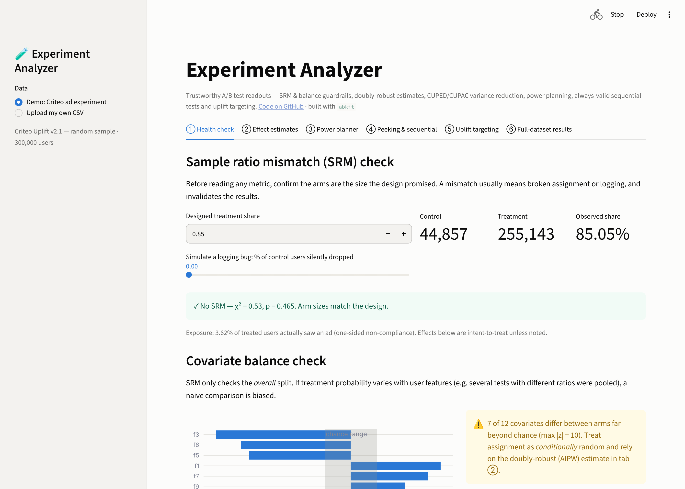
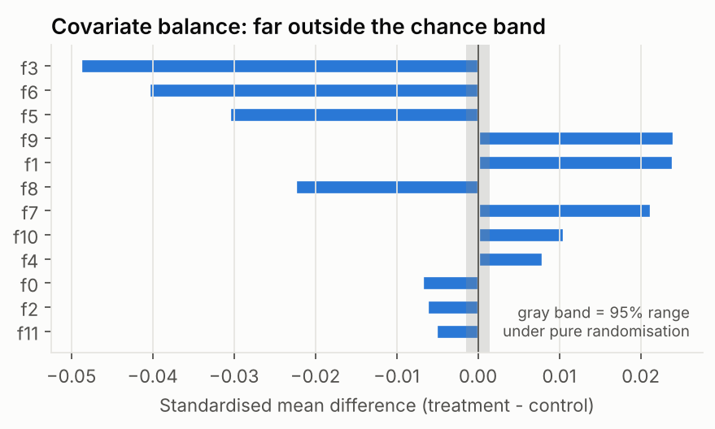
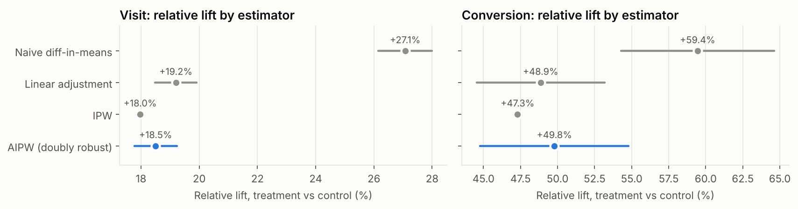
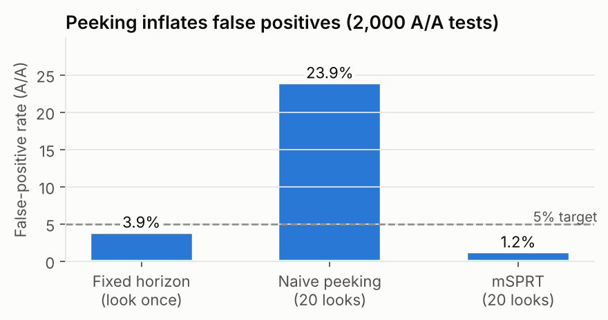
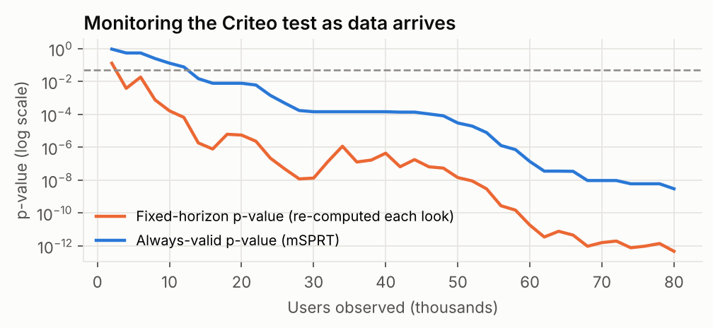
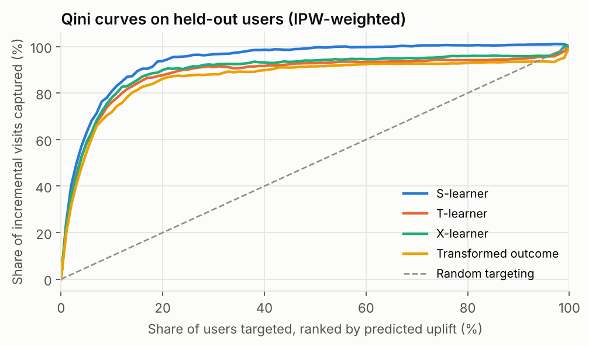
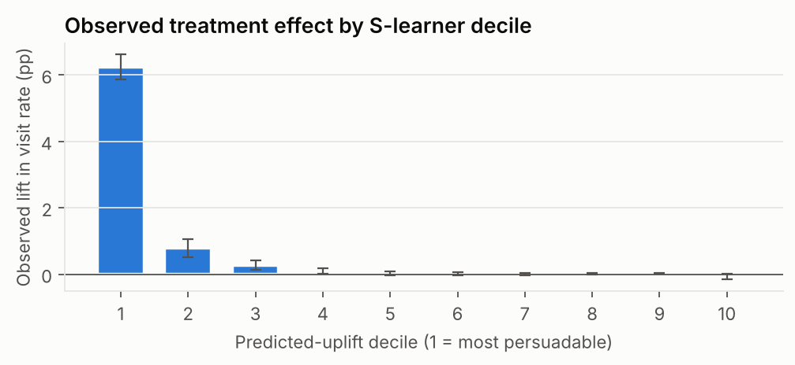
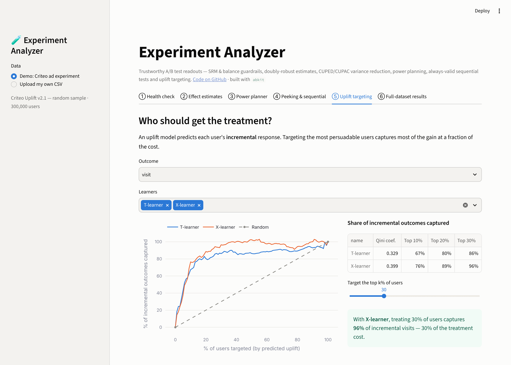

# Experiment Analyzer — trustworthy A/B testing & uplift modeling on 14M users

[](https://github.com/ericazhaoxy/ab-uplift-kit/actions)
[](https://ab-uplift-kit.streamlit.app)

An end-to-end experimentation toolkit (`abkit`) plus an interactive dashboard, applied to the
**Criteo Uplift v2.1** dataset: 13,979,592 users from a real randomized advertising incrementality test.

It goes through what a data scientist checks before trusting an A/B test readout — and it found a real
problem in this dataset that a naive analysis misses.



## Key results

| Question | Finding |
|---|---|
| Is the split healthy? | **SRM check passes** (p = 0.999), but **covariate balance fails**: all 12 features differ between arms by 7 to 65 standard errors (propensity-model AUC 0.510). Assignment is only *conditionally* random. |
| What is the real ad effect? | Naive diff-in-means says **+27.1%** visits. The doubly-robust **AIPW** estimate is **+18.5%** (95% CI 17.8–19.2%) — the naive number **overstates the lift by ~46%**. Linear adjustment (+19.2%) and IPW (+18.0%) agree with AIPW. Conversion: naive +59.4% vs AIPW **+49.8%**. |
| Effect of actually *seeing* an ad? | Only 3.6% of treated users were exposed. Wald/LATE estimate: **+20.8 pp** visit rate among exposed users. |
| How much faster can tests run? | **CUPAC** (cross-fitted LightGBM prediction as covariate) removes **33.6% of variance** in visit across 1,000 A/A re-randomizations, keeping the false-positive rate at **4.0%** and CI coverage at **96%**. A 2% MDE test needs **3.87M → 2.57M users (−34%)**. |
| Can we check results daily? | Not with fixed-horizon p-values: across 2,000 A/A tests with 20 looks, "stop when p < 0.05" gives a **23.9% false-positive rate** (vs 3.9% when looking once). **mSPRT always-valid p-values** keep it at **1.2%**. |
| Who should see the ad? | An S-learner uplift model ranks 4.2M held-out users: **targeting the top 10% captures 81%** of incremental visits, **the top 20% captures 94%** (IPW-weighted Qini 0.439, best of 4 learners). |

## 1. Health checks: SRM passes, balance doesn't

A sample-ratio-mismatch test compares observed arm sizes with the design (85/15). It passes — and the
toolkit shows that dropping just 0.5% of control users (a typical logging bug) would trip it (p = 1.5e-11).

But SRM only checks the *overall* split. A standardized-mean-difference check on the 12 pre-treatment
features shows imbalances of up to 0.049 SD, where pure randomization predicts about 0.0007 at this sample size.
The dataset was assembled from several incrementality tests, so a plausible explanation is that those tests
used different treatment ratios. Users with the highest propensity to be treated are also the most
responsive, so the naive comparison is biased upward.



## 2. Effect estimates: naive vs doubly robust

| Estimator | Visit lift | Conversion lift |
|---|---|---|
| Naive diff-in-means | +27.1% [26.2, 28.0] | +59.4% [54.3, 64.6] |
| Linear regression adjustment (Lin 2013) | +19.2% [18.5, 19.9] | +48.9% [44.5, 53.2] |
| IPW (Hajek) | +18.0% | +47.3% |
| **AIPW (doubly robust)** | **+18.5% [17.8, 19.2]** | **+49.8% [44.8, 54.8]** |

AIPW combines a propensity model *e(x)* and outcome models *μ₁(x), μ₀(x)* (all 3-fold cross-fitted
LightGBM) and stays consistent if either model is right. CIs use influence-function standard errors and
the delta method for relative lift.



## 3. Variance reduction (CUPED / CUPAC), validated with A/A tests

Because the real assignment isn't uniform, variance reduction is validated where randomization *is* clean:
1,000 A/A re-randomizations of 500k real users each.

| Metric | Variance removed by CUPAC | False-positive rate (raw → CUPAC) | 95% CI coverage |
|---|---|---|---|
| Visit | **33.6%** | 4.6% → 4.0% | 96.0% |
| Conversion | 9.8% | 5.2% → 4.8% | 95.2% |

Required sample size scales with variance, so CUPAC cuts the users needed for a 2%-MDE visit test from
3.87M to 2.57M.

## 4. Sequential testing: the cost of peeking



Monitoring an 80k-user slice of the real experiment, the fixed-horizon p-value first drops below 0.05 after
4k users, while the always-valid mSPRT p-value needs 14k: that gap is the price of being allowed to look
at any time. At a fixed maximum sample size, mSPRT also has less power (29% vs 58% for a +5% lift with
200k users), so it pays off when early stopping on large effects matters.



## 5. Uplift modeling: who is persuadable?

Four meta-learners (S, T, X, transformed outcome), trained on 3M users and evaluated on 4.19M held-out
users. Qini curves are inverse-propensity weighted, since treatment probability varies with features.

| Learner | Qini (IPW) | Top 10% | Top 20% | Top 30% |
|---|---|---|---|---|
| **S-learner** | **0.439** | **81%** | **94%** | **97%** |
| X-learner | 0.393 | 78% | 90% | 92% |
| T-learner | 0.381 | 76% | 88% | 91% |
| Transformed outcome | 0.362 | 72% | 86% | 88% |



The top decile shows a +6.2 pp lift in visit rate, against +0.75 pp on average. Most of the ad's
incremental visits come from users who were already likely to engage.



## Dashboard

`streamlit run streamlit_app.py` — or open the [live demo](https://ab-uplift-kit.streamlit.app).
It runs on a 300k-user sample of Criteo, or on **any CSV you upload** (treatment column, outcomes, covariates):

1. **Health check**: SRM with a "simulate a logging bug" slider, plus the covariate balance chart
2. **Effect estimates**: naive vs linear adjustment vs AIPW, with CIs and LATE
3. **Power planner**: users needed vs MDE, with and without CUPAC
4. **Peeking & sequential**: run your own A/A simulations, watch mSPRT vs naive p-values
5. **Uplift targeting**: train learners, compare Qini curves, pick a targeting threshold
6. **Full-dataset results**: the 14M-user numbers above



## Repository layout

```
abkit/                     # the library
  srm.py                   # sample ratio mismatch (chi-square)
  stats.py                 # Welch / z-tests, delta-method relative-lift CIs
  causal.py                # balance table, cross-fitted propensity/outcome models, AIPW, IPW
  variance_reduction.py    # CUPED, Lin regression adjustment (chunked, 14M rows in 2.5 GB), CUPAC
  power.py                 # sample size, MDE, power — with variance reduction
  sequential.py            # mSPRT always-valid p-values, peeking simulator
  uplift.py                # S/T/X/transformed-outcome learners, (IPW-)Qini, deciles
  data.py                  # Criteo loader + synthetic data with known ground truth
scripts/run_analysis.py    # full pipeline -> results/results.json + figures (~25 min on 2 CPUs)
streamlit_app.py           # dashboard
tests/                     # 12 tests: unbiasedness, A/A false-positive rates, AIPW vs confounding, ...
```

## Reproduce

```bash
pip install -r requirements-dev.txt
pytest -q                                            # 12 tests, ~25 s

# data: 297 MB. The official link (go.criteo.net) now redirects to a dead host;
# this mirror serves the identical file (SHA-256 2716e1bf…616dc matches the original checksum)
curl -L -o data/criteo-research-uplift-v2.1.csv.gz \
  https://github.com/jszymon/uplift_sklearn_data/releases/download/Criteo/criteo-research-uplift-v2.1.csv.gz

python scripts/run_analysis.py                       # full 14M rows
python scripts/run_analysis.py --sample-frac 0.05    # quick run
python scripts/run_analysis.py --synthetic           # no download needed
streamlit run streamlit_app.py
```

## Limitations

- Criteo features are anonymized, and the reason for the imbalance (pooled tests) is inferred, not documented.
  AIPW assumes no unmeasured confounding given the 12 features.
- The dataset has no timestamps, so sequential monitoring uses a random arrival order.
- The LATE estimate assumes the ad can only affect users who were actually exposed (exclusion restriction).
- Uplift deciles are ranked by predicted *absolute* uplift, which correlates with baseline engagement.

## Data & references

Data: Criteo AI Lab, *Criteo Uplift Prediction Dataset* (v2.1), CC BY-NC-SA 4.0. The 300k-row sample in
`data/demo_sample.parquet` is redistributed under the same license.
Diemert, Betlei, Renaudin, Amini (2018). *A Large Scale Benchmark for Uplift Modeling.* AdKDD.

Methods: Deng et al. (2013) CUPED · Lin (2013) regression adjustment · Chernozhukov et al. (2018) DML/AIPW ·
Johari et al. (2017) always-valid inference · Künzel et al. (2019) meta-learners · Radcliffe (2007) Qini.

Code: MIT License.
